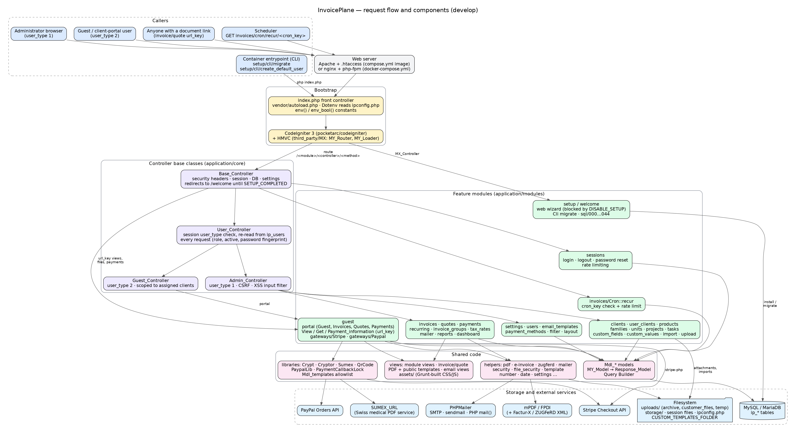

# InvoicePlane Architecture

This page describes how the code on `develop` is put together: how a request reaches a feature
module, what the shared layers do, and which storage and external services the app talks to.
For installation see [INSTALLATION.md](INSTALLATION.md); for container settings see
[CONTAINER_DEPLOYMENT.md](CONTAINER_DEPLOYMENT.md).



The diagram source is [`diagrams/architecture.dot`](diagrams/architecture.dot) (Graphviz).
After editing it, run [`diagrams/render.sh`](diagrams/render.sh) to regenerate
`architecture.png` and `architecture.svg`, and commit all three files.

## Stack

| Layer | What `develop` uses |
|-------|---------------------|
| Language / framework | PHP 8.2+ on CodeIgniter 3 (`pocketarc/codeigniter` via Composer) with HMVC modules (`application/third_party/MX`) |
| Database | MySQL / MariaDB through the CodeIgniter Query Builder; tables are prefixed `ip_` |
| Configuration | `ipconfig.php`, a dotenv-format file loaded by `vlucas/phpdotenv` in `index.php` and read with `env()` / `env_bool()` |
| PDF / e-invoice | mPDF + FPDI, with Factur-X / ZUGFeRD XML embedding (`zugferd_helper.php`, `e-invoice_helper.php`) |
| Email | PHPMailer (`application/modules/mailer/helpers/phpmailer_helper.php`) |
| Online payments | Stripe Checkout (`stripe/stripe-php`) and PayPal Orders (`application/libraries/gateways/PaypalLib.php`, Guzzle) |
| Frontend | Server-rendered PHP views, jQuery, Bootstrap 3 (Sass), built by Grunt (`yarn build`) into `assets/` |

## Request flow

1. **Web server.** The `compose.yml` image runs Apache with the repo's `htaccess` copied to
   `.htaccess`; the legacy `docker-compose.yml` runs nginx in front of php-fpm. Every request is
   sent to `index.php`.
2. **Front controller (`index.php`).** Exits if `ipconfig.php` is missing, loads
   `vendor/autoload.php`, loads `ipconfig.php` with Dotenv, defines `env()` / `env_bool()` and a
   few constants (`IP_DEBUG`, `SUMEX_SETTINGS`, `SUMEX_URL`), sets error reporting from `CI_ENV`,
   then boots CodeIgniter from `vendor/pocketarc/codeigniter/system`.
3. **Routing.** `MY_Router` / `MY_Loader` extend the HMVC router and loader, so a URL
   `/<module>/<controller>/<method>/<args>` maps to
   `application/modules/<module>/controllers/<Controller>.php`. The default route is
   `dashboard` (`application/config/routes.php`).
4. **Controller base classes (`application/core`).**
   - `Base_Controller` sets security headers, blocks non-AJAX calls to AJAX controllers and GET
     calls to `delete` URLs, starts the session and redirects to `/welcome` until
     `SETUP_COMPLETED=true`. After setup it connects to the database and loads settings,
     language and common helpers.
   - `User_Controller` requires a session `user_type` and re-reads the user from `ip_users` on
     every request, so a role change, a deactivated account or a password change ends existing
     sessions (credential fingerprint from `ip_security_helper.php`).
   - `Admin_Controller` (`user_type` 1) adds no-cache headers, a CSRF token header for AJAX,
     `ensure_valid_post_request()` and automatic XSS filtering of POST input (`XSS_Protection_Trait`),
     and warns admins when `SETUP_COMPLETED` / `DISABLE_SETUP` are not both set.
   - `Guest_Controller` (`user_type` 2) loads the clients assigned to the user
     (`user_clients`) and returns 403 when there are none; guest queries are scoped to
     those client IDs.
   - Controllers that must work without a login extend `Base_Controller` directly:
     `sessions/Sessions`, `invoices/Cron`, and the guest `View`, `Get`,
     `Payment_information` and `gateways/*` controllers, which find documents by their
     unguessable `url_key`. `setup/Setup`, `setup/Cli` and `layout/Layout` extend
     `MX_Controller`; `welcome/Welcome` extends `CI_Controller`.
5. **Models and views.** Module models (`Mdl_*`) extend `MY_Model` / `Response_Model` and use the
   Query Builder. Views are plain PHP templates rendered through the `layout` module.

## Modules (`application/modules`)

| Area | Modules | Notes |
|------|---------|-------|
| Authentication | `sessions` | Login, logout, password reset; IP-, account- and email-based rate limiting recorded in `ip_login_log` |
| Billing | `invoices`, `quotes`, `payments`, `invoice_groups`, `tax_rates`, `mailer`, `reports`, `dashboard` | Invoices include recurring invoices (`Recurring`, `Mdl_invoices_recurring`) and Sumex (Swiss medical) invoices; `invoice_groups` hold numbering schemes |
| Master data | `clients`, `user_clients`, `products`, `families`, `units`, `projects`, `tasks`, `custom_fields`, `custom_values`, `import`, `upload` | `user_clients` links guest users to the clients they may see; `import` loads CSV files from `uploads/import` |
| Administration | `settings`, `users`, `email_templates`, `payment_methods`, `filter`, `layout` | Settings are key/value rows in `ip_settings`, loaded on every request by `Mdl_settings` |
| Client portal | `guest` | Logged-in guest portal plus public `url_key` pages: invoice/quote view, PDF download, quote approve/reject, attachments, online payment |
| Install / upgrade | `setup`, `welcome` | Web wizard and CLI; schema is built from `setup/sql/000_1.0.0.sql` to `044_1.7.3.sql` |

## Key flows

- **Install and upgrade.** On a manual install, `/setup` walks through language, prerequisites,
  database configuration (written to `ipconfig.php`), table install or upgrade and the first
  user. Set `DISABLE_SETUP=true` and `SETUP_COMPLETED=true` afterwards. The `compose.yml`
  container instead generates `ipconfig.php` from environment variables with
  `DISABLE_SETUP=true`, then runs `php index.php setup/cli/migrate` and
  `php index.php setup/cli/create_default_user` on every start (see `resources/docker/entrypoint.sh`).
- **Invoice / quote PDFs.** `pdf_helper.php` renders the selected template from
  `application/views/invoice_templates` or `quote_templates` (or an allowlisted custom template
  in `CUSTOM_TEMPLATES_FOLDER`) with mPDF. Template names come only from the constants in
  `Mdl_templates` and `ipconfig.php`; the filesystem is never scanned. When a client has an
  e-invoicing profile, `e-invoice_helper.php` loads an XML generator from
  `application/libraries/XMLtemplates` and a config from `application/helpers/XMLconfigs`, and
  the XML is embedded in the PDF (Factur-X / ZUGFeRD). No XML generators ship in this repo; they
  come from the separate InvoicePlane-e-invoices project.
- **Email.** `mailer_helper.php` (`email_invoice`, `email_quote`) builds the message from an email
  template, attaches the PDF and sends it with PHPMailer using the `email_send_method` setting
  (SMTP, sendmail or PHP `mail()`).
- **Online payment.** A client opens `guest/payment_information/form/<url_key>` and picks a
  gateway. Stripe: `guest/gateways/stripe/create_checkout_session` creates a Checkout session
  and Stripe returns to `.../callback/<session_id>`. PayPal: `guest/gateways/paypal/paypal_create_order`
  and `paypal_capture_payment` call the PayPal Orders API through `PaypalLib`.
  `PaymentCallbackLock` serialises callbacks so one payment is not recorded twice; payments land
  in `ip_payments` and gateway responses in `ip_merchant_responses`. Gateway credentials are settings,
  encrypted with `Crypt`; the available gateways are listed in `application/config/payment_gateways.php`.
- **Recurring invoices.** An external scheduler calls `invoices/cron/recur/<cron_key>`. The key
  must match the `cron_key` setting (failed attempts are rate-limited); due recurring invoices
  are copied into new invoices and optionally emailed.

## Storage

| Location | Contents |
|----------|----------|
| MySQL / MariaDB | All business data (`ip_clients`, `ip_invoices`, `ip_quotes`, `ip_payments`, `ip_settings`, `ip_users`, …), login and rate-limit logs, schema version in `ip_versions` |
| `ipconfig.php` | Base URL, database credentials, `ENCRYPTION_KEY`, setup flags and feature switches (template from `ipconfig.php.example`) |
| `uploads/` | `archive/` (generated PDFs), `customer_files/` (attachments), `import/` (CSV imports), `temp/` |
| `storage/` | Runtime storage; also used for sessions when `SESS_SAVE_PATH` points there |
| Session files | `SESS_SAVE_PATH`, falling back to `sys_get_temp_dir()` (`sess_driver` defaults to `files`) |
| `CUSTOM_TEMPLATES_FOLDER` | Optional custom PDF / public templates, used only when listed in the allowlist constants |

## Repository layout

```
index.php                 Front controller (Dotenv + CodeIgniter bootstrap)
ipconfig.php.example      Configuration template; copy to ipconfig.php
application/
  config/                 CodeIgniter config (config.php, routes.php, payment_gateways.php, …)
  core/                   Base_Controller, User/Admin/Guest_Controller, MY_Model, Response_Model, MY_Router, MY_Loader
  helpers/                Global helpers (pdf, e-invoice, mailer, security, …) and XMLconfigs/
  libraries/              Crypt, Cryptor, Sumex, QrCode, PaymentCallbackLock, gateways/PaypalLib, XMLtemplates/
  modules/                HMVC feature modules (controllers/, models/, views/ per module)
  views/                  Invoice/quote PDF and public templates, email and report views
  language/               Translations (managed through Crowdin)
  third_party/MX/         HMVC extension
assets/                   Sass/JS sources and Grunt-built CSS/JS/fonts (themes: invoiceplane, invoiceplane_blue)
resources/docker/         Containerfile + entrypoint.sh (compose.yml) and per-service Dockerfiles (docker-compose.yml)
uploads/, storage/        Runtime data (see Storage)
.github/                  Docs, changelog, security advisories, CI workflows
```

## Build and checks

- `composer install` installs PHP dependencies; `yarn install && yarn build` runs Grunt to compile
  Sass and bundle JavaScript into `assets/`.
- CI on push/PR: `php-lint.yml` (`php -l` on every PHP file), `test-frontend.yml` (`yarn build`),
  and the Docker workflows (`compose-yml-test.yml`, `docker-compose-yml-test.yml`). PHPUnit,
  PHPStan and Pint workflows run on demand.
